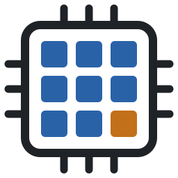
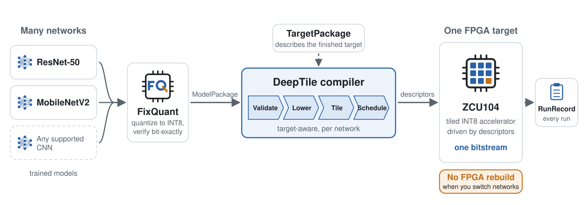
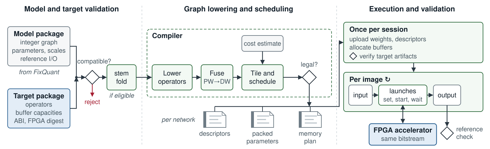
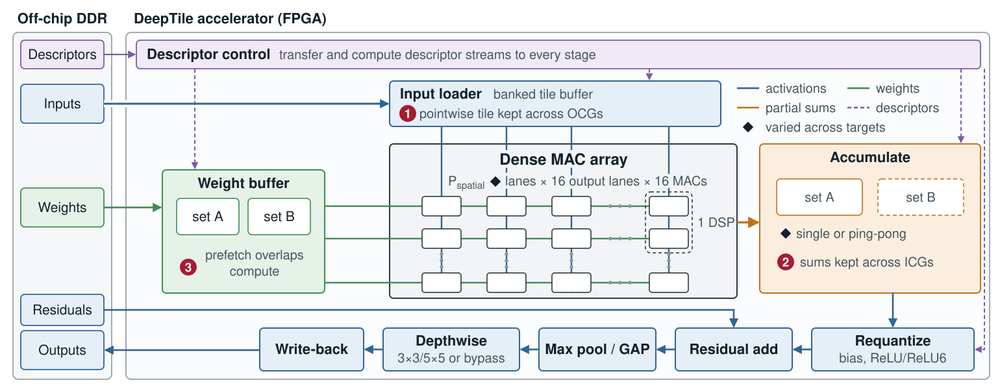
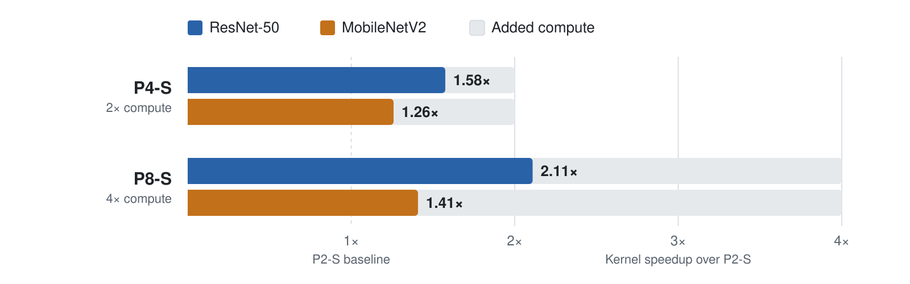

<div align="center">

<picture>
  <source media="(prefers-color-scheme: dark)" srcset="docs/assets/figures/deeptile-logo-dark.svg">
  
</picture>

# DeepTile

### Reusable INT8 CNN Inference with Fixed FPGA Hardware and Target-Aware Software

An open-source hardware–software framework that runs quantized CNNs on an FPGA
accelerator built once and then reused. A target-aware compiler maps each
supported network onto the implemented target through descriptors, and a
runtime drives the accelerator directly, so changing networks needs a new
compilation, not a new FPGA build.

[](LICENSE)
&nbsp;
[](docs/index.md)
&nbsp;
[](https://www.xilinx.com/products/boards-and-kits/zcu104.html)

</div>

---

## Overview

<p align="center">
<picture>
  <source media="(prefers-color-scheme: dark)" srcset="docs/assets/figures/deeptile-hero-dark.svg">
  
</picture>
</p>

DeepTile separates the reusable hardware target from the model-specific mapping:

- **FixQuant** exports a quantized model in a hardware-independent canonical
  form.
- The **DeepTile compiler** validates and lowers the graph, selects legal tiles,
  builds schedules, and emits kernel descriptors for a specific target.
- The **host runtime** packs tensors, prepares device memory once per session,
  drives the compute unit directly through its control registers, and records
  every run with the identities of the artifacts that produced it.
- The **FPGA kernel** executes the descriptor stream on a signed-INT8 tiled
  datapath with a dense MAC array, a fused 3x3/5x5 depthwise stage, and a
  streaming output path.

Each FPGA target has a fixed bitstream and hardware interface. The compiler
adapts the schedule, parameters, and tensor organization for each network.

## Packages and Run Records

DeepTile uses three artifact types to keep deployment and evaluation
reproducible:

| Artifact | Purpose |
|---|---|
| **ModelPackage** | Quantized graph, parameters, and integer reference tensors for validation |
| **TargetPackage** | Matching host executable, FPGA binary, boot image, and hardware configuration |
| **RunRecord** | Model and target identities, evaluation settings, validation or accuracy results, and timing |

## Architecture

The bitstream fixes the operator paths, buffers and execution interface; each
network brings its own compiled artifacts. The compiler and runtime can improve
without rebuilding the target.

<p align="center">
  
</p>

The accelerator broadcasts activations and weights across a dense array of
P_spatial × 16 × 16 multiply–accumulates per cycle, keeps partial sums on chip
across input-channel groups, and post-processes each output tile in a
streaming path:

<p align="center">
  
</p>

See [How DeepTile works](docs/concepts/how-it-works.md) and
[Hardware architecture](docs/concepts/hardware-architecture.md) for the details.

## Scope

DeepTile supports locally built FPGA accelerator targets. The validated
configuration and workloads are:

| Property | Current support |
|---|---|
| FPGA platform | AMD/Xilinx ZCU104 (`XCZU7EV`) |
| Toolchain | Vitis/Vivado 2024.2 |
| Kernel clock | 200 MHz |
| Arithmetic | Signed INT8 activations and weights with wider accumulation |
| Execution | Batch-one, descriptor-driven tiled inference |
| Validated networks | ResNet-50, ResNet-18, MobileNetV2, EfficientNet-Lite0, and custom `vgg16_tilecnn` |
| Dense kernels | Square, up to 7x7; stride 1 or 2 |
| Other operations | Fused 3x3 and 5x5 depthwise convolution, residual add, max pool, global average pool, ReLU and ReLU6, and output requantization |
| Implemented targets | P2 and P4 ping-pong; P2, P4 and P8 single-buffer |

See [Build a hardware target](docs/guides/build-a-target.md) to generate a
target package, and [Port to another board](docs/guides/port-to-another-board.md)
to adapt the framework to another platform.

## Results

All five networks run on every target from the same bitstreams, evaluated on
3,923 ImageNet-mini validation images with DeepTile v2.0.1. Accuracy is
identical on every target. The times below are accelerator kernel time per
image in milliseconds, the sum of layer latencies under direct launch control.
P2-S, P4-S and P8-S differ in spatial width alone; each S/PP pair differs in
partial-sum buffering alone. MobileNetV2 and EfficientNet-Lite0 reach
application throughputs of up to 172 and 163 images per second.

| Network | Top-1 | P2-S | P2-PP | P4-S | P4-PP | P8-S |
|---|---:|---:|---:|---:|---:|---:|
| ResNet-50 | 78.61% | 49.44 | 46.37 | 31.38 | 28.46 | 23.43 |
| ResNet-18 | 69.46% | 20.90 | 20.41 | 12.40 | 11.93 | 9.00 |
| MobileNetV2 | 69.95% | 6.32 | 5.27 | 5.02 | 4.43 | 4.49 |
| EfficientNet-Lite0 | 74.00% | 7.24 | 6.15 | 5.57 | 4.91 | 4.91 |
| VGG-class (`vgg16_tilecnn`) | 71.86% | 177.71 | 174.27 | 100.29 | 96.86 | 63.42 |

The custom VGG-class model is not stock VGG-16; it uses supported pooling and
classifier geometry. Predictions are byte-identical across all five targets.
The routed kernels use 551 DSPs at P2, 805 at P4 and 1,316 at P8, with ping-pong
partial sums adding 32 BRAM tiles at fixed width.
[Reproduce the results](docs/guides/reproduce-results.md) regenerates these
measurements on your own board.

### Width and workload

At equal partial-sum buffering, each target doubles the compute of the one
before. The grey track is that added compute; the coloured bar is the kernel
speedup each network achieves over P2-S.

<p align="center">
<picture>
  <source media="(prefers-color-scheme: dark)" srcset="docs/assets/figures/deeptile-scaling-dark.svg">
  
</picture>
</p>

Dense networks convert more of the added width into speed than
depthwise-separable ones, which depend more on ping-pong partial sums. A
reusable target should be chosen for its intended workload mix rather than by
theoretical peak alone. On the same board, one AMD DPU core has a shorter
execution time on every network, while P4-PP reaches a higher fraction of its
arithmetic peak; cgra4ml runs three of the five networks, and Arm processing
dominates its inference time.

## Quick Start

### 1. Clone the framework

```bash
git clone --recursive https://github.com/mokweri/DeepTile.git
cd DeepTile
```

If the repository was cloned without submodules:

```bash
git submodule update --init --recursive
```

### 2. Build and test the native framework

Requirements are CMake, a C++17 compiler, Python 3 for diagnostic-tool tests,
and OpenCV for image decoding.

```bash
make -C scripts tools
make -C scripts runtime_tests
make -C scripts reference_tests
ctest --test-dir build/tools --output-on-failure
```

### 3. Fetch and export a model

Install the pinned FixQuant submodule in a Python environment containing its
dependencies, then select that interpreter for the workflow:

```bash
python -m pip install --no-deps -e ./FixQuant
export FIXQUANT_PYTHON="$(command -v python)"

make -C scripts model-fetch \
    ZOO_MODEL=resnet50/imagenet1k/int8-tqt@v1.0.0
make -C scripts model-export \
    ZOO_MODEL=resnet50/imagenet1k/int8-tqt@v1.0.0
```

The verified package is published under
`build/models/resnet50/imagenet1k/int8-tqt/v1.0.0/`. Fetching is explicit;
export never downloads a checkpoint implicitly. See
[Installation](docs/getting-started/installation.md) for the Python environment
and [Bring your own model](docs/guides/bring-your-own-model.md) for the
release IDs of all five validated networks.

### 4. Run the HLS correctness gate

Initialize the Vitis 2024.2 environment, then run C simulation against the
exported integer reference:

```bash
make -C scripts hls-csim DEEPTILE_CASE=best_case_3x3_s1
```

Synthesis, co-simulation, and trace options are documented in
[`scripts/README.md`](scripts/README.md).

### 5. Build the standard hardware target

The repository default is the P4 ping-pong configuration:

```bash
make -C scripts hw-all VITIS_MODE=hw TARGET_VERSION=v2.0.0
```

The complete target is generated under
`build/hw/zcu104-p4-pp_v2.0.0/`, including the matching `deeptile` host,
`deeptile.xclbin`, `target.json`, build provenance, and SD-card package. Hardware
build prerequisites and platform defaults are described in
[`scripts/README.md`](scripts/README.md).

### 6. Deploy and run

Configure the `zcu104` SSH alias described in the deployment guide, then deploy
the complete target:

```bash
TARGET_DIR="$PWD/build/hw/zcu104-p4-pp_v2.0.0" \
    ./scripts/hw/deploy_zcu104.sh
ssh zcu104 'sudo reboot'
```

A reboot is required after a full deployment because `BOOT.BIN`, not the
XCLBIN alone, establishes the active fabric configuration. The runtime checks
that the deployed boot image crossed a reboot boundary before execution.

On the board, a packaged single-input reference run has the following form:

```bash
./deeptile target.json data/resnet50_int8_tilecnn/graph.json \
    --runs 3 --output results/resnet50-single
```

Dataset evaluation uses the same executable with `--dataset`, `--topk`, and a
prepared ImageNet-style directory. See
[Evaluate on a dataset](docs/guides/evaluate-on-a-dataset.md). For MobileNetV2 and
EfficientNet-Lite0, set `DEEPTILE_FUSE_DW=1` to run their depthwise layers
fused.

## Repository Layout

| Path | Responsibility |
|---|---|
| [`src/common/`](src/common/) | Shared architecture configuration, packed types, descriptors, and kernel ABI |
| [`src/kernel/`](src/kernel/) | HLS accelerator, data movement, dense/depthwise compute, accumulation, fusion, and output processing |
| [`src/compiler/`](src/compiler/) | Graph import, validation, lowering, tiling, scheduling, cost decisions, and descriptor generation |
| [`src/host/`](src/host/) | Runtime planning, tensor packing, stem folding, direct launch control, dataset evaluation, reference execution, and HLS/XRT backends |
| [`FixQuant/`](FixQuant/) | Pinned quantization, model-zoo, and graph-export submodule |
| [`scripts/`](scripts/) | Supported model, native, HLS, hardware, packaging, deployment, and evaluation commands |
| [`tests/`](tests/) | Compiler, host, kernel, and cross-component integration tests |
| [`data/`](data/) | Curated regression ModelPackages, HLS cases, and dataset metadata |
| `build/` | Generated models, native tools, HLS projects, and hardware targets; ignored by Git |
| [`docs/`](docs/) | User documentation: installation, concepts, guides, and specifications |

The compiler is linked into each target's host executable, so a model is
compiled on the board when it is run.

## Documentation

The full documentation is built with MkDocs from [`docs/`](docs/). Preview it
locally with:

```bash
make -C scripts docs-venv    # once
make -C scripts docs-serve   # then open http://127.0.0.1:8000
```

Key pages:

- [How DeepTile works](docs/concepts/how-it-works.md) -- the pipeline, the three
  artifact contracts, and what changes when you switch networks.
- [Quick start](docs/getting-started/quick-start.md) -- from a clone to a model
  running on the ZCU104.
- [Bring your own model](docs/guides/bring-your-own-model.md) -- released
  models, FixQuant export, and other quantizers.
- [Build a hardware target](docs/guides/build-a-target.md) -- configurations and
  the hardware build.
- [Reproduce the evaluation](docs/guides/reproduce-results.md) -- rebuild the
  models and hardware targets, then repeat the benchmark runs.
- [Graph handoff specification](docs/reference/graph-handoff-spec.md) and
  [TargetPackage specification](docs/reference/target-package.md) -- the model
  and target contracts.
- [Command reference](docs/reference/commands.md) -- make targets, host options,
  and tools.

## License

DeepTile is licensed under the [Apache License 2.0](LICENSE). The FixQuant
submodule is a separate project and retains its own license and repository
history.

## Citation

If you use DeepTile in your work, cite the software repository:

```bibtex
@misc{mogaka2026deeptile,
  author = {Mogaka, Obed M. and Forsberg, H{\aa}kan and Daneshtalab, Masoud},
  title  = {{DeepTile}},
  year   = {2026},
  howpublished = {GitHub repository},
  url    = {https://github.com/mokweri/DeepTile}
}
```

---

<div align="center">
<sub>DeepHERO Lab · Mälardalen University</sub>
</div>
