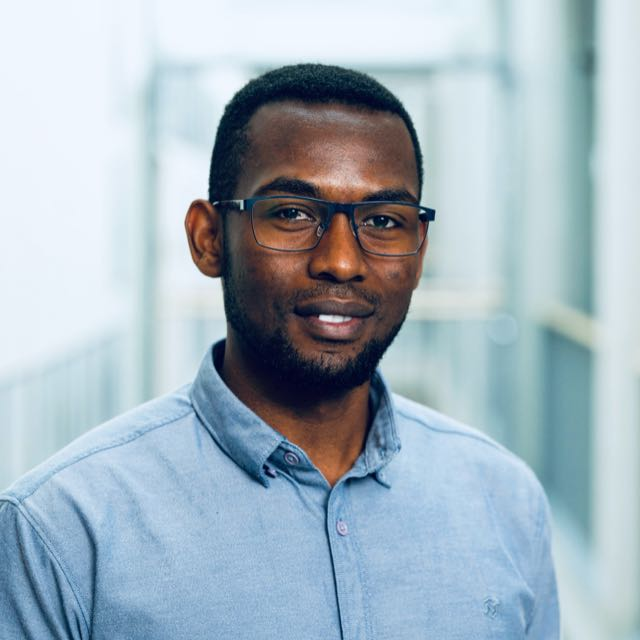

---
hide:
  - toc
---

# Author

{ .author-photo }

## Obed M. Mogaka

**PhD student in Computer Science** 
DeepHERO Lab, Mälardalen University, Västerås, Sweden

[:simple-orcid: 0009-0000-9110-7898](https://orcid.org/0009-0000-9110-7898){ .md-button }
[:fontawesome-brands-linkedin: LinkedIn](https://www.linkedin.com/in/obed-mogaka-23477a6a/){ .md-button }
[:fontawesome-brands-github: mokweri](https://github.com/mokweri){ .md-button }

Obed M. Mogaka develops DeepTile as part of his doctoral research at Mälardalen
University. His research interests include FPGA-based deep learning
acceleration, hardware–software co-design, high-level synthesis, and
memory-efficient architectures for edge inference. He also teaches VHDL and
FPGA design.

He received the B.Sc. degree in electrical and electronics engineering from Jomo
Kenyatta University of Agriculture and Technology, Kenya, in 2019, and the M.Sc.
degree in electronics and communication engineering from the Egypt-Japan
University of Science and Technology, Egypt, in 2024.

## Related work

DeepTile and FixQuant were developed with Håkan Forsberg and Masoud Daneshtalab
at Mälardalen University.

- **DeepTile: Reusable INT8 CNN Inference with Fixed FPGA Hardware and
  Target-Aware Software.** O. M. Mogaka, H. Forsberg, and M. Daneshtalab.
  Manuscript in preparation, 2026.
- **Bridging Quantization and Deployment: A Fixed-Point Workflow for FPGA
  Accelerators.** O. M. Mogaka, H. Forsberg, and M. Daneshtalab. *2025 IEEE
  28th International Symposium on Design and Diagnostics of Electronic Circuits
  and Systems (DDECS)*, pp. 123–126, 2025.
  [doi:10.1109/DDECS63720.2025.11006791](https://doi.org/10.1109/DDECS63720.2025.11006791)

See [Research](research.md) for the paper's materials and how to cite DeepTile.
