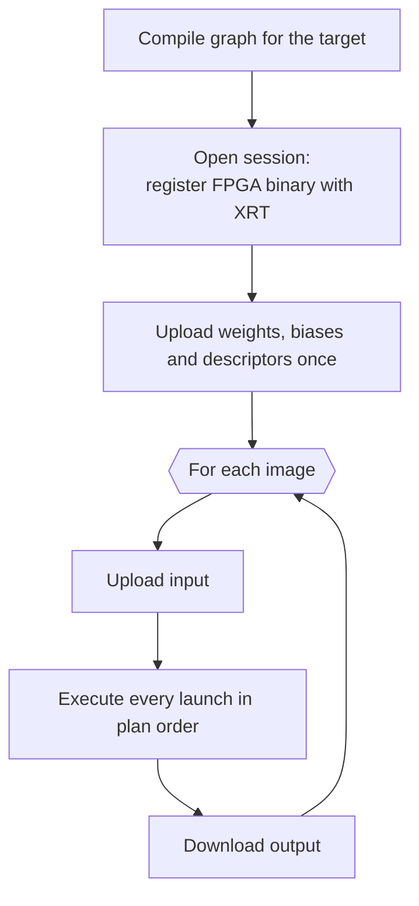
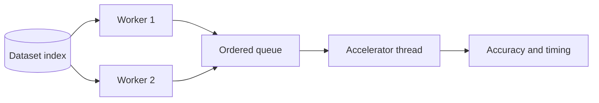

# Execution and timing

This page describes what happens when you run a model with the `deeptile` host,
and how to interpret the timings it reports.

## How a run proceeds

A single `deeptile` invocation compiles the model, opens one session on the
accelerator, and then processes every input through that session.

Weights and descriptors are uploaded once per session, so each image exchanges
only activations with the accelerator. A compiled network becomes a fixed
sequence of launches — 54 for ResNet-50, 21 for ResNet-18, 36 for fused
MobileNetV2, 34 for fused EfficientNet-Lite0 and 16 for `vgg16_tilecnn` — and
the number is a property of the compiled graph, not of the input.

The host does not program the FPGA. On the ZCU104 the fabric is configured at
boot from `BOOT.BIN`, and the host verifies that the running boot image is the
one the TargetPackage names before it opens the session.

## Launch control

By default the host drives the compute unit directly through its control
registers: it writes each launch's arguments, starts it, and waits for it to
finish before starting the next. This costs about 3 µs per launch, against
about 65 µs through XRT's command scheduler, and preserves the dependency
between consecutive layers.

Because each launch completes before the next begins, **a launch's reported
time is its latency**, plus those few microseconds of host control. Within a
launch, data movement, computation, output processing and the next weight
epoch's transfer still overlap across tiles.

`DEEPTILE_XRT_LAUNCH=run` selects XRT's scheduler instead. Under that mode the
kernel's `ap_ctrl_chain` protocol lets a launch start while the previous one
drains, so per-launch time becomes an initiation interval and can be
misattributed between neighbouring launches. Every RunRecord states the mode
under `execution.launch_mode`.

!!! tip "Sanity-check any throughput figure"
    A target's theoretical peak is $2 \times P_{\mathrm{spatial}} \times 16
    \times 16 \times f_{\mathrm{clk}}$, or $102.4 \times P_{\mathrm{spatial}}$
    GOPS at 200 MHz. A figure above it points to a measurement error.

## Stem folding

When the host loads a graph whose first convolution is a stride-2 convolution
over a 3-channel image, it rewrites it by space-to-depth: each $2 \times 2$
input neighbourhood is folded into 12 channels and the convolution becomes an
equivalent stride-1 one with half the kernel size. The result is bit-identical
and the stem runs two to three times faster, with no change to the hardware.
Dataset preparation writes the folded input layout directly.
`DEEPTILE_STEM_S2D=0` disables the rewrite, and RunRecords state it under
`execution.stem_space_to_depth`.

## Dataset runs

In dataset mode, image decoding and preprocessing run on worker threads while a
single thread owns the accelerator:

On the ZCU104's Arm cores, preparing an image takes longer than the
accelerator needs for the lighter networks, so overlapping the two is what
keeps the accelerator busy. The pipeline is deterministic: the same dataset
produces byte-identical tensors and identical predictions at any worker count.
Worker count (`--workers`, default 2) and queue depth (`--queue`, default twice
the worker count) affect throughput only.

Each image is decoded (only the region the crop needs when the host is built
with libjpeg), resized with a
Pillow-compatible bilinear filter, normalized with the ImageNet mean and
standard deviation, quantized to signed 8-bit, and packed into the
accelerator's channel-group layout. The default `eval` convention resizes the
shorter side to 256 pixels and centre-crops to 224 × 224, the standard ImageNet
evaluation transform. [Evaluate on a dataset](../guides/evaluate-on-a-dataset.md)
covers the details.

## Timing scopes

A run reports several intervals. Keep them apart.

| Scope | What it measures | Use it for |
|---|---|---|
| **Kernel time** | Host-observed time to complete all accelerator launches for one inference, from a prepared input to the completed output | Accelerator latency and throughput |
| **Upload and download** | Input handoff to the device and output retrieval, outside kernel time | Data-movement cost per image |
| **End-to-end** | Wall time per image of the whole dataset pipeline, including preparation | What an application sees |

Application throughput is evaluated images divided by dataset wall time. For a
network whose kernel time is short compared with image preparation, that rate
describes the host pipeline rather than the accelerator.

To time one layer, run a single-layer graph such as those under
`data/phase1_testcases/` and `data/p2_testcases/`, or read the per-launch
profile of a full-network run (`--csv` or `--output`): under direct launch
control each line is that launch's latency. `--measure-latency` times input
upload through output download for each single-image run.

## CPU contention

Kernel time is measured on the host, so it also absorbs scheduling delay when
preprocessing threads leave no core for the thread that drives the
accelerator. The host reports kernel time as mean, median, and minimum, and
warns when the worker count leaves no core spare.

A mean well above the minimum is the signature of contention. Raising
`--workers` can improve end-to-end throughput while inflating kernel time, so
quote accelerator latency only from a run without contention.

## What a run reports

With `--output DIR`, the host writes a self-contained receipt:

- `run.json` — a `deeptile.run.v1` record with the SHA-256 of the model
  manifest, FPGA binary, and boot image that actually ran; the dataset digest;
  the preprocessing convention; worker and queue settings; the launch mode and
  stem folding; the source revision; and the accuracy and timing results.
- `launch-profile.csv` in single-image mode, or `predictions.csv` in dataset
  mode, with top-k predictions in dataset order.

`--output` refuses to overwrite an existing `run.json`, so each directory
describes exactly one execution. If a compile-time switch departed from its
default, the record lists it under `execution.schedule_flags`, since such a run
is not reproducible from the model and target alone.

Top-k predictions use an explicit tie rule — the lowest class index wins — so
accuracy is reproducible even though integer logits tie often.
