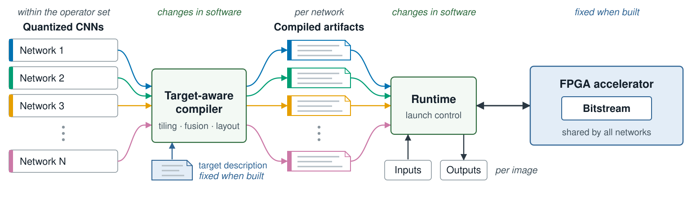

# How DeepTile works

DeepTile runs quantized CNNs on an FPGA accelerator that is built once and then
reused. The central idea is a strict split between two kinds of decision:

- **Decisions that depend on the network** — how to tile each layer, in what
  order to traverse it, which operations to fuse — are made in software by the
  DeepTile compiler, every time you run a model.
- **Decisions that depend on the hardware** — how many multiply–accumulate
  units exist, how large the on-chip buffers are — are fixed when you build a
  hardware target.

The accelerator itself contains no knowledge of layer shapes. It executes a
stream of small, fixed-size *descriptors* that the compiler generates. That is
why a new network needs a new compilation, not a new FPGA build.

{ .paper-figure }

## The pipeline

{ .paper-figure }

1. **Quantize and export.** [FixQuant](https://github.com/mokweri/FixQuantTool)
   trains or loads a quantized model and exports a **ModelPackage**: the graph,
   signed 8-bit weights and biases, and, for release-grade packages, a
   validation input with the integer reference output that the accelerator
   must reproduce exactly.
2. **Compile for a target.** The compiler reads the ModelPackage and the
   **TargetPackage** of the hardware you intend to use. It validates the graph
   against that target, lowers each layer to one or more accelerator launches,
   fuses eligible layer pairs, chooses legal tiles and weight epochs, and emits
   the descriptors. Before compiling, the host applies exact rewrites that
   leave the result bit-identical, such as folding a stride-2 RGB stem.
3. **Execute.** The host runtime packs tensors into the accelerator's memory
   layout, uploads weights and descriptors once, and then runs the launches for
   each input, driving the compute unit directly through its control
   registers.
4. **Record.** Every run can write a **RunRecord**: which model, which target,
   which dataset, and the resulting accuracy and timing.

Compilation happens inside the host executable at start-up, so in practice you
run one command on the board and the compiler, runtime, and kernel all take
part.

## The three artifacts

DeepTile connects its stages through three versioned files, so every result can
be traced to exactly what produced it.

| Artifact | What it contains | Produced by |
|---|---|---|
| **ModelPackage** | Quantized graph, integer tensors, fixed-point metadata, checksums, and optional validation input and reference output | FixQuant, or any exporter that follows the [graph handoff specification](../reference/graph-handoff-spec.md) |
| **TargetPackage** | The FPGA binary, its boot image, kernel ABI, architecture parameters, capabilities, checksums, and build provenance | The hardware build ([details](../reference/target-package.md)) |
| **RunRecord** | Model and target identities, dataset and preprocessing, runtime settings, accuracy, and timing | The host, with `--output` |

Each artifact carries SHA-256 digests. Before running, the host checks that the
FPGA binary and boot image on the board are the ones the TargetPackage names,
and that the compiler was built for the same architecture.

## What changes when you switch networks

| Switching networks changes | Switching networks does not change |
|---|---|
| The compiled schedule and descriptors | The FPGA bitstream and boot image |
| The packed weights and biases | The kernel ABI |
| The activation memory plan | The host executable |

Building a different *target* — more parallelism, different buffering, or
another board — is the only thing that requires a new FPGA build.

!!! note "A host executable belongs to one target"
    Each target's host executable is compiled with that target's architecture
    parameters, and the compiler plans tiles using them. Always run a target
    with the `deeptile` executable built alongside it. The TargetPackage check
    rejects a mismatched pair.

## Exact-reference validation

Release-grade ModelPackages carry integer reference outputs exported by
FixQuant. HLS simulation and packaged single-input validation runs on the board
compare the accelerator output against them; any difference is an error rather
than a warning. Passing that exact-reference run shows that the selected model
and target reproduced the exported integer result for the packaged input.

Graph-only developer packages may omit inputs and references. They remain
valid compiler inputs, but cannot provide this end-to-end comparison. Dataset
evaluation instead reports classification accuracy for the selected listing
and records the preprocessing convention in its RunRecord.

## Next steps

- [Hardware architecture](hardware-architecture.md) explains how the
  accelerator executes a layer.
- [Execution and timing](execution-and-timing.md) explains how a run proceeds
  and what the reported timings mean.
- [Quick start](../getting-started/quick-start.md) takes you from a clone to a
  model running on the board.
